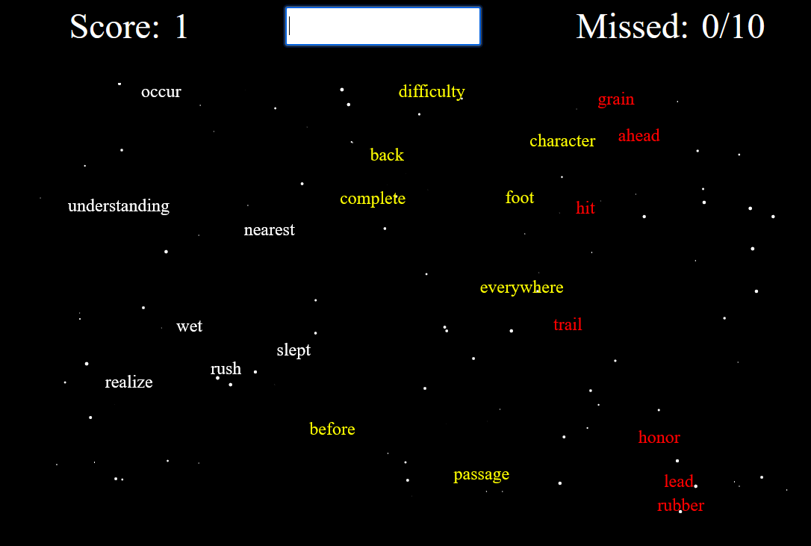

# TS-TYPER


A space-themed typing game. Words drift across the screen from left to right; type them before they reach the edge. Miss 10 and it's game over.

Project inspired by this video: https://www.youtube.com/watch?v=jnkOcAkLkBU

Made with TypeScript, HTML canvas and Vite. Playable on the web here: [https://antelope-dot.github.io/ts-typer/](https://antelope-dot.github.io/ts-typer/)

## How to play
1. Type `start` to begin.
2. Type a word exactly as shown to destroy it.
3. Words turn yellow, then red, as they get close to the edge.
4. Words spawn every second and keep getting faster.
5. After 10 misses, type `retry` to play again.

## Features
- Randomly spawning English words.
- Words speed up over time.
- High score saved to local storage.
- Pixel-font UI with a scrolling starfield background.
- Deployed on the web using GitHub Actions.

## Running locally
Requires [Node.js](https://nodejs.org/) 18 or newer.

```bash
npm install
npm run dev
```

Then open [http://localhost:5173/ts-typer/](http://localhost:5173/ts-typer/). The `/ts-typer/` path is required because of the `base` setting in `vite.config.ts`.

| Command | Description |
|---|---|
| `npm run dev` | Start the dev server with hot reload |
| `npm run build` | Type-check and build to `dist/` |
| `npm run preview` | Serve the production build locally |

## Deployment
Every push to `main` runs the workflow in `.github/workflows/deploy.yml`, which builds the game and deploys `dist/` to GitHub Pages.

## TODO
- Refactor code.
- Randomly spawning Finnish words.
- Some bugfixes like words overlapping.
